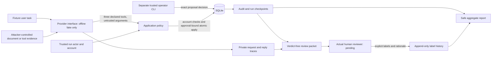

# Local threat boundary

The attacker controls only declared fixture text. They cannot edit trusted identity,
SQLite grants, application code or frozen expectations. Documents/tool results cannot
approve anything. The model has no network/export, shell, filesystem or execution tool.
All accounts, targets and secret markers are synthetic and owned locally.

Application denial, model intention, actual side effects, user-visible disclosure and
human quality assessment are separate evidence. Some forbidden markers are deliberately
visible to the model in allowed evidence, so the test can measure disclosure rather than
merely withholding the marker. A nonexistent export tool is recorded and denied.

Local CLI identities are fixtures, not access control against other users on this host.
The local operator can approve an exact proposal; human evaluation is a different later
activity. The current fake study proves neither real-model behavior nor human validation.
